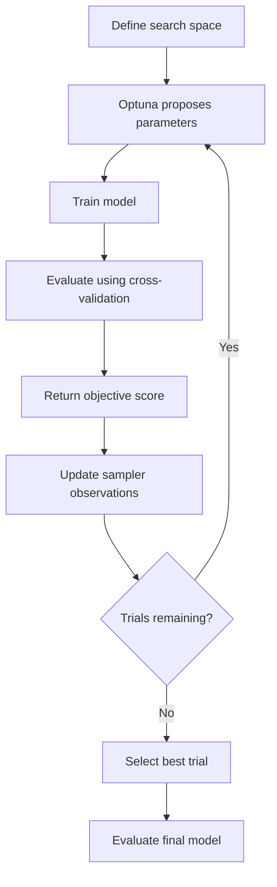

# Optuna Bayesian Hyperparameter Optimization

A practical, end-to-end implementation of hyperparameter optimization using **Optuna, Bayesian optimization with Tree-structured Parzen Estimator (TPE), cross-validation, and machine learning model evaluation**.

The repository demonstrates how to systematically search for effective hyperparameters, improve model performance, analyze optimization trials, and compare tuned models against their baseline configurations.

## Table of Contents

1. [Introduction](#1-introduction)
2. [Objectives](#2-objectives)
3. [What Is Hyperparameter Tuning?](#3-what-is-hyperparameter-tuning)
4. [Parameters vs. Hyperparameters](#4-parameters-vs-hyperparameters)
5. [Why Hyperparameter Optimization Matters](#5-why-hyperparameter-optimization-matters)
6. [Hyperparameter Optimization Methods](#6-hyperparameter-optimization-methods)
7. [Introduction to Optuna](#7-introduction-to-optuna)
8. [Bayesian Optimization and TPE](#8-bayesian-optimization-and-tpe)
9. [How Optuna Works](#9-how-optuna-works)
10. [Project Workflow](#10-project-workflow)
11. [Installation and Setup](#11-installation-and-setup)
12. [Repository Structure](#12-repository-structure)
13. [Practical Implementation](#13-practical-implementation)
14. [Objective Function Explained](#14-objective-function-explained)
15. [Cross-Validation and Data Leakage](#15-cross-validation-and-data-leakage)
16. [Optimization Metrics](#16-optimization-metrics)
17. [Visualizing Optimization Results](#17-visualizing-optimization-results)
18. [Model-Specific Hyperparameter Tuning](#18-model-specific-hyperparameter-tuning)
19. [Advanced Optuna Features](#19-advanced-optuna-features)
20. [Common Mistakes](#20-common-mistakes)
21. [Best Practices](#21-best-practices)
22. [Limitations](#22-limitations)
23. [Learning Outcomes](#23-learning-outcomes)
24. [Future Improvements](#24-future-improvements)
25. [References](#25-references)

---

## 1. Introduction

Hyperparameter optimization is the process of finding suitable hyperparameter values that improve the performance of a machine learning model.

Machine learning algorithms require configuration choices before or during training. These choices influence model complexity, convergence, regularization, generalization, and computational cost.

For example, a Random Forest classifier has hyperparameters such as:

- `n_estimators`: Number of decision trees.
- `max_depth`: Maximum depth of each tree.
- `min_samples_split`: Minimum samples required to split an internal node.
- `min_samples_leaf`: Minimum samples required at a leaf node.
- `max_features`: Number or proportion of features considered when splitting.

Choosing these values manually can be time-consuming. Exhaustively testing every combination can also become computationally expensive.

**Optuna** automates this process by suggesting configurations, evaluating them through an objective function, and using previous trial results to guide subsequent experiments.

This repository explores the process from baseline model training to optimization, evaluation, and result visualization.

## 2. Objectives

The primary objectives are:

- Understand the difference between model parameters and hyperparameters.
- Implement hyperparameter optimization using Optuna.
- Understand Bayesian optimization and the TPE sampler.
- Define objective functions for classification tasks.
- Use stratified cross-validation for reliable performance estimation.
- Tune Logistic Regression, Random Forest, and XGBoost models.
- Compare baseline and optimized models.
- Visualize optimization history and hyperparameter importance.
- Avoid data leakage during model selection.
- Understand the trade-offs between model performance and computational cost.

## 3. What Is Hyperparameter Tuning?

Hyperparameter tuning is a model-selection process in which different configurations are evaluated to identify one that performs well according to a chosen metric.

Suppose a Random Forest model is evaluated using the following configurations:

| Trial | Number of trees | Maximum depth | Cross-validation F1 |
|---|---:|---:|---:|
| 1 | 50 | 5 | 0.78 |
| 2 | 100 | 10 | 0.84 |
| 3 | 200 | 15 | 0.87 |
| 4 | 300 | 8 | 0.85 |

These values are illustrative.

If F1-score is the optimization objective, Trial 3 is the best among the configurations tested.

However, the best result found during a finite search is not necessarily the global optimum. Optimization quality depends on the search space, objective, sampler, number of trials, data, and evaluation procedure.

### The optimization problem

Hyperparameter tuning can be represented as:

\[
\theta^* = \arg\max_{\theta \in \Theta} f(\theta)
\]

Where:

- \(\theta\) represents a candidate hyperparameter configuration.
- \(\Theta\) represents the search space.
- \(f(\theta)\) represents the model's evaluation score.
- \(\theta^*\) represents the best configuration found.

For a loss-minimization problem, the objective instead becomes:

\[
\theta^* = \arg\min_{\theta \in \Theta} L(\theta)
\]

Optuna supports both directions through `direction="maximize"` and `direction="minimize"`.

## 4. Parameters vs. Hyperparameters

These concepts are related but different.

### Model parameters

Parameters are learned from training data.

Examples:
- Weights and bias in Logistic Regression.
- Split thresholds and feature choices in a fitted Decision Tree.
- Coefficients learned by a linear model.

### Hyperparameters

Hyperparameters configure the learning process or model structure.

Examples:
- `C` in Logistic Regression.
- `max_depth` in Random Forest.
- `learning_rate` in XGBoost.
- `n_estimators` in ensemble models.
- Regularization strength and sampling configuration.

**Key distinction:** model parameters are learned during fitting; hyperparameters are selected through configuration and model-selection experiments.

## 5. Why Hyperparameter Optimization Matters

A model with reasonable hyperparameters can perform better than the same model with poorly chosen settings.

Optimization can help with:

**Model complexity:** Control underfitting and overfitting.

**Regularization:** Adjust the balance between fitting training data and generalizing to unseen data.

**Convergence:** Tune parameters affecting optimization speed and stability.

**Generalization:** Select configurations that perform consistently across validation folds.

**Computational efficiency:** Avoid spending resources evaluating every possible combination.

However, hyperparameter tuning does not guarantee an improvement on unseen data. Its effectiveness depends on the quality of the data, the objective function, and the evaluation methodology.

## 6. Hyperparameter Optimization Methods

Several search strategies are commonly used.

### 6.1 Manual Search

Hyperparameters are selected through experience and experimentation.

**Advantages**
- Simple for small experiments.
- Useful for understanding individual parameters.

**Limitations**
- Difficult to reproduce systematically.
- Can be biased toward familiar configurations.
- Becomes inefficient as the search space grows.

### 6.2 Grid Search

Grid Search evaluates every specified combination of hyperparameter values.

For example:

- `max_depth`: 5, 10, 15
- `n_estimators`: 50, 100, 200

Total configurations:

\[
3 \times 3 = 9
\]

With cross-validation using five folds, this requires up to 45 model fits.

**Advantage:** Systematic and exhaustive within the specified grid.

**Limitation:** Computationally expensive for large search spaces.

### 6.3 Random Search

Random Search samples configurations from predefined distributions.

It can explore a wider range of values than Grid Search when only a limited number of experiments are affordable.

**Advantage:** Often a strong baseline for hyperparameter search.

**Limitation:** It does not explicitly use previous trial outcomes to guide the next suggestion.

### 6.4 Bayesian Optimization

Bayesian optimization uses information from previously evaluated configurations to select promising future candidates.

It is especially useful when model evaluations are expensive and the search space contains many possible configurations.

**Advantages**
- Can use previous evaluations to guide search.
- Often explores promising regions more efficiently than uninformed search.
- Supports continuous, integer, categorical, and conditional hyperparameters.

**Limitations**
- Performance depends on the search space and sampler.
- Sequential suggestions can limit parallel efficiency.
- Does not guarantee finding the global optimum.

### 6.5 Optuna with TPE

Optuna is an optimization framework that supports multiple sampling strategies.

Its default sampler is generally `TPESampler`, which uses the Tree-structured Parzen Estimator approach.

Rather than exhaustively testing every possible combination, TPE learns from observed trial results and proposes promising candidates.

This repository uses Optuna with TPE as its main optimization method.

## 7. Introduction to Optuna

Optuna is an open-source framework for hyperparameter optimization and experiment management.

Its core components include:

| Component | Purpose |
|---|---|
| `Study` | Manages an optimization experiment. |
| `Trial` | Represents one evaluated configuration. |
| `suggest_float()` | Samples floating-point hyperparameters. |
| `suggest_int()` | Samples integer hyperparameters. |
| `suggest_categorical()` | Selects from discrete choices. |
| `objective()` | Defines what each trial should optimize. |
| `TPESampler` | Suggests configurations using TPE. |
| `best_params` | Returns the best configuration found. |
| `best_value` | Returns its objective score. |
| `best_trial` | Provides details of the best trial. |

### Basic example

```python
import optuna

def objective(trial):
    x = trial.suggest_float("x", -10, 10)
    return (x - 3) ** 2

study = optuna.create_study(direction="minimize")
study.optimize(objective, n_trials=50)

print("Best parameters:", study.best_params)
print("Best value:", study.best_value)
```

This example minimizes a mathematical function. It demonstrates the optimization mechanism without involving a machine learning model.

## 8. Bayesian Optimization and TPE

### 8.1 Bayesian optimization intuition

Imagine testing different `max_depth` and `learning_rate` values for a machine learning model.

At first, the optimizer has limited information about which configurations perform well.

After evaluating multiple trials, it accumulates observations:

\[
D = \{(\theta_i, f(\theta_i))\}_{i=1}^{n}
\]

Where:

- \(\theta_i\) is a tested configuration.
- \(f(\theta_i)\) is its observed performance.
- \(D\) is the collected set of observations.

The optimizer uses this information to select subsequent candidates.

The objective is not simply to try random values. It is to balance exploring uncertain regions and exploiting configurations likely to perform well.

### 8.2 What is TPE?

TPE stands for **Tree-structured Parzen Estimator**.

It models the distribution of hyperparameter values conditional on whether their objective outcomes are good or comparatively poor.

Conceptually, TPE estimates two distributions:

\[
l(x) = p(x \mid y < y^*)
\]

\[
g(x) = p(x \mid y \geq y^*)
\]

Here:

- \(x\) represents a candidate hyperparameter value.
- \(y\) represents the objective value, assuming minimization.
- \(y^*\) is a threshold used to separate good and poorer observations.
- \(l(x)\) models configurations associated with better results.
- \(g(x)\) models configurations associated with poorer results.

TPE uses these distributions to guide candidate selection, commonly favoring values with a high ratio:

\[
\frac{l(x)}{g(x)}
\]

This is an intuitive representation of the acquisition logic, not the complete implementation. Actual TPE behavior includes additional sampling and modeling details.

For a maximization objective, the good-versus-poor interpretation is adjusted to the optimization direction.

### 8.3 Why use TPE?

- Supports mixed hyperparameter types.
- Handles conditional search spaces.
- Uses previously observed results.
- Works well as a general-purpose sampler for many ML tasks.
- Integrates directly with Optuna studies.

**Important:** TPE is a Bayesian-optimization-style sequential model-based search method. It is not the same as Gaussian-process Bayesian optimization, Grid Search, or Random Search.

## 9. How Optuna Works

The typical optimization loop is:

1. Define a search space.
2. Create an objective function.
3. Request a configuration from Optuna.
4. Train the model with that configuration.
5. Evaluate the model using validation data or cross-validation.
6. Return the objective score.
7. Use the trial result to inform subsequent suggestions.
8. Repeat for the requested number of trials.
9. Retrieve and evaluate the best configuration.



The objective function is the connection between Optuna and the machine learning algorithm.

Optuna does not automatically know whether a model is good. The objective function defines how performance is measured.

## 10. Project Workflow

The repository follows this workflow:

1. Generate or load a classification dataset.
2. Split the data into training and test sets.
3. Establish a baseline model.
4. Define the hyperparameter search space.
5. Configure an Optuna study with TPE.
6. Evaluate each trial with stratified cross-validation.
7. Optimize the selected metric.
8. Retrieve the best hyperparameters.
9. Refit the selected model on the complete training set.
10. Evaluate it on the untouched test set.
11. Compare baseline and optimized results.
12. Visualize the optimization history and parameter importance.

The test set is reserved for final evaluation, not for choosing hyperparameters.

## 11. Installation and Setup

### Requirements

- Python 3.10 or a compatible newer version.
- NumPy
- pandas
- scikit-learn
- Optuna
- Matplotlib

Install the dependencies:

```bash
pip install numpy pandas scikit-learn optuna matplotlib
```

For XGBoost experiments, install:

```bash
pip install xgboost
```

### Clone the repository

```bash
git clone https://github.com/YOUR_USERNAME/Optuna-Bayesian-Hyperparameter-Optimization.git

cd Optuna-Bayesian-Hyperparameter-Optimization
```

Replace `YOUR_USERNAME` with your GitHub username.

## 12. Repository Structure

```text
Optuna-Bayesian-Hyperparameter-Optimization/
│
├── README.md
├── requirements.txt
├── logistic_regression_tuning.py
├── random_forest_tuning.py
├── xgboost_tuning.py
├── optuna_study_visualization.py
│
└── results/
    └── .gitkeep
```

Each script focuses on a separate model or task.

- `logistic_regression_tuning.py`: Regularization and solver-related tuning.
- `random_forest_tuning.py`: Tree count, tree depth, and split constraints.
- `xgboost_tuning.py`: Boosting rate, tree complexity, and regularization.
- `optuna_study_visualization.py`: Analysis of a saved Optuna study.

The implementation below is a complete starting example for Random Forest tuning.

## 13. Practical Implementation

### 13.1 Problem statement

The objective is to tune a Random Forest classifier using Optuna's TPE sampler and select hyperparameters that maximize mean stratified cross-validation F1-score.

A synthetic binary classification dataset is used so the experiment can run without downloading external files.

### 13.2 Complete Python implementation

Create `random_forest_tuning.py`:

```python
import optuna
import numpy as np

from sklearn.datasets import make_classification
from sklearn.model_selection import (
    train_test_split,
    StratifiedKFold,
    cross_val_score,
)
from sklearn.ensemble import RandomForestClassifier
from sklearn.metrics import (
    accuracy_score,
    precision_score,
    recall_score,
    f1_score,
    roc_auc_score,
    classification_report,
)
from sklearn.dummy import DummyClassifier


RANDOM_STATE = 42


# --------------------------------------------------
# 1. Generate a classification dataset
# --------------------------------------------------

X, y = make_classification(
    n_samples=3000,
    n_features=20,
    n_informative=10,
    n_redundant=5,
    n_classes=2,
    weights=[0.85, 0.15],
    class_sep=1.0,
    random_state=RANDOM_STATE,
)


# --------------------------------------------------
# 2. Split into training and test sets
# --------------------------------------------------

X_train, X_test, y_train, y_test = train_test_split(
    X,
    y,
    test_size=0.20,
    stratify=y,
    random_state=RANDOM_STATE,
)


# --------------------------------------------------
# 3. Define cross-validation
# --------------------------------------------------

cv = StratifiedKFold(
    n_splits=5,
    shuffle=True,
    random_state=RANDOM_STATE,
)


# --------------------------------------------------
# 4. Establish a baseline
# --------------------------------------------------

baseline = RandomForestClassifier(
    n_estimators=100,
    random_state=RANDOM_STATE,
    n_jobs=-1,
)

baseline_scores = cross_val_score(
    baseline,
    X_train,
    y_train,
    cv=cv,
    scoring="f1",
    n_jobs=1,
)

print("Baseline mean CV F1:", baseline_scores.mean())


# --------------------------------------------------
# 5. Define the Optuna objective
# --------------------------------------------------

def objective(trial):

    params = {
        "n_estimators": trial.suggest_int(
            "n_estimators", 100, 500, step=50
        ),
        "max_depth": trial.suggest_int(
            "max_depth", 3, 30
        ),
        "min_samples_split": trial.suggest_int(
            "min_samples_split", 2, 20
        ),
        "min_samples_leaf": trial.suggest_int(
            "min_samples_leaf", 1, 10
        ),
        "max_features": trial.suggest_categorical(
            "max_features", ["sqrt", "log2", None]
        ),
        "class_weight": trial.suggest_categorical(
            "class_weight", [None, "balanced", "balanced_subsample"]
        ),
    }

    model = RandomForestClassifier(
        **params,
        random_state=RANDOM_STATE,
        n_jobs=-1,
    )

    scores = cross_val_score(
        model,
        X_train,
        y_train,
        cv=cv,
        scoring="f1",
        n_jobs=1,
    )

    return float(np.mean(scores))


# --------------------------------------------------
# 6. Create the Optuna study
# --------------------------------------------------

sampler = optuna.samplers.TPESampler(
    seed=RANDOM_STATE
)

study = optuna.create_study(
    direction="maximize",
    sampler=sampler,
    study_name="random_forest_optimization",
)


# --------------------------------------------------
# 7. Run hyperparameter optimization
# --------------------------------------------------

study.optimize(
    objective,
    n_trials=40,
    show_progress_bar=True,
)


# --------------------------------------------------
# 8. Display the best configuration
# --------------------------------------------------

print("\nBest CV F1-score:", study.best_value)
print("\nBest hyperparameters:")

for parameter, value in study.best_params.items():
    print(f"{parameter}: {value}")


# --------------------------------------------------
# 9. Refit the selected model
# --------------------------------------------------

best_model = RandomForestClassifier(
    **study.best_params,
    random_state=RANDOM_STATE,
    n_jobs=-1,
)

best_model.fit(X_train, y_train)


# --------------------------------------------------
# 10. Evaluate on the untouched test set
# --------------------------------------------------

y_pred = best_model.predict(X_test)
y_prob = best_model.predict_proba(X_test)[:, 1]

print("\nFinal Test Results")
print("------------------")
print("Accuracy:", accuracy_score(y_test, y_pred))
print("Precision:", precision_score(y_test, y_pred, zero_division=0))
print("Recall:", recall_score(y_test, y_pred, zero_division=0))
print("F1-score:", f1_score(y_test, y_pred, zero_division=0))
print("ROC-AUC:", roc_auc_score(y_test, y_prob))

print("\nClassification Report:")
print(classification_report(y_test, y_pred, zero_division=0))


# --------------------------------------------------
# 11. Save the optimization results
# --------------------------------------------------

study.trials_dataframe().to_csv(
    "optuna_trials.csv",
    index=False,
)

print("\nTrial results saved to optuna_trials.csv")
```

### 13.3 Run the implementation

```bash
python random_forest_tuning.py
```

The script prints the baseline cross-validation F1-score, the best trial's score, the selected hyperparameters, and the final test metrics.

The exact results depend on the installed library versions, dataset, and sampled trials. Do not add invented scores to the README; record the values produced by your actual run.

### 13.4 Why this implementation is structured this way

**Training/test split:** The test data remains separate from hyperparameter selection.

**Stratified cross-validation:** Each fold attempts to preserve the class proportions.

**Objective function:** Returns the mean F1-score across five validation folds.

**TPE sampler:** Uses prior trial results to guide future suggestions.

**Final refitting:** The selected model is trained on the entire training split before test evaluation.

**Saved trials:** `optuna_trials.csv` enables further analysis and reproducibility checks.

The dataset is synthetic and the example focuses on tuning mechanics. For real-world projects, use a representative dataset and select metrics based on the actual application.

## 14. Objective Function Explained

The objective function is the most important component of an Optuna experiment.

```python
def objective(trial):
    max_depth = trial.suggest_int("max_depth", 3, 30)
    n_estimators = trial.suggest_int("n_estimators", 100, 500)

    model = RandomForestClassifier(
        max_depth=max_depth,
        n_estimators=n_estimators,
        random_state=42,
    )

    scores = cross_val_score(
        model,
        X_train,
        y_train,
        cv=cv,
        scoring="f1",
    )

    return scores.mean()
```

The function performs four tasks:

1. Requests candidate hyperparameters from the current trial.
2. Constructs a model using those parameters.
3. Evaluates the model using cross-validation.
4. Returns a numeric score to Optuna.

Optuna then uses the returned value to rank the trial and inform later suggestions.

### Choosing the optimization direction

Use:

```python
optuna.create_study(direction="maximize")
```

For metrics where higher is better, such as F1-score, recall, ROC-AUC, or average precision.

Use:

```python
optuna.create_study(direction="minimize")
```

For metrics where lower is better, such as mean squared error, mean absolute error, or log loss.

The direction must match the meaning of the objective function.

## 15. Cross-Validation and Data Leakage

Cross-validation estimates how consistently a model performs across different training and validation splits.

For classification tasks, `StratifiedKFold` helps preserve the relative class distribution in each fold.

For example, with five folds, the model is trained and validated five times using different partitions of the training set.

The objective is typically:

\[
\bar{S} = \frac{1}{K}\sum_{i=1}^{K} S_i
\]

Where:

- \(K\) is the number of folds.
- \(S_i\) is the validation score for fold \(i\).
- \(\bar{S}\) is the mean validation score.

### Avoiding data leakage

Data leakage occurs when information from validation or test data improperly influences model training or selection.

Common examples include:

- Scaling the complete dataset before cross-validation.
- Oversampling before splitting training and test data.
- Selecting features using the full dataset before evaluation.
- Tuning hyperparameters against the final test set.

For preprocessing, use an appropriate scikit-learn `Pipeline` so that transformations are fitted within each training fold.

For resampling, use `imblearn.pipeline.Pipeline` so that resampling occurs only on the training portion of each fold.

For an unbiased final assessment, reserve the test set until the model and its hyperparameters have been selected. If the project involves many repeated tuning rounds or substantial feature/model selection, nested cross-validation can provide a more rigorous performance estimate.

## 16. Optimization Metrics

The metric should reflect the actual problem rather than simply maximize a convenient number.

| Metric | Best suited for |
|---|---|
| Accuracy | Overall correctness when class balance and error costs make it appropriate |
| Precision | Reducing false positives |
| Recall | Reducing false negatives |
| F1-score | Balancing precision and recall |
| ROC-AUC | Ranking positive examples above negative examples |
| Average Precision | Evaluating precision-recall ranking performance |
| Log Loss | Evaluating the quality of predicted probabilities |
| MAE | Regression error in original target units |
| RMSE | Regression error that penalizes large errors more heavily |
| \(R^2\) | Comparing regression fit against a mean-prediction baseline |

### Why F1-score?

In an imbalanced classification problem, accuracy can be misleading.

For example, if 95% of samples belong to the negative class, a model that predicts every sample as negative can achieve 95% accuracy while detecting no positive examples.

F1-score is the harmonic mean of precision and recall:

\[
F_1 = 2 \cdot \frac{P \cdot R}{P + R}
\]

Where \(P\) is precision and \(R\) is recall.

For problems where positive-class detection is especially important, recall or average precision may be a better objective. The metric should be chosen before running optimization.

## 17. Visualizing Optimization Results

Optuna provides built-in visualization tools through `optuna.visualization`.

Install Plotly if required by your environment:

```bash
pip install plotly
```

Create `optuna_study_visualization.py`:

```python
import optuna
import plotly.io as pio

# Load the previously saved study if using persistent storage.
# The study must have been created with the same study name
# and storage configuration.

study = optuna.load_study(
    study_name="random_forest_optimization",
    storage="sqlite:///optuna_study.db",
)

fig_history = optuna.visualization.plot_optimization_history(study)
fig_history.show()

fig_importance = optuna.visualization.plot_param_importances(study)
fig_importance.show()

fig_parallel = optuna.visualization.plot_parallel_coordinate(study)
fig_parallel.show()
```

**Important:** This visualization script expects a persistent SQLite study. The main example above creates an in-memory study, so its results disappear when the process exits. To make the visualization script work, create the study in the main script with persistent storage:

```python
study = optuna.create_study(
    study_name="random_forest_optimization",
    storage="sqlite:///optuna_study.db",
    load_if_exists=True,
    direction="maximize",
    sampler=optuna.samplers.TPESampler(seed=42),
)
```

Then run the optimization script first and the visualization script afterward.

### Optimization history

Shows how the best objective value evolves over the trials.

### Hyperparameter importance

Estimates which parameters were most influential within the completed study. This is an exploratory diagnostic, not proof of causation or a guarantee of importance on other datasets.

### Parallel coordinate plot

Helps explore relationships between hyperparameter configurations and trial scores.

### Saving plots

You can export Plotly figures to HTML for interactive inspection or save static images when the required export dependencies are installed.

## 18. Model-Specific Hyperparameter Tuning

Different algorithms require different search spaces.

### 18.1 Logistic Regression

Potential hyperparameters:

- `C`: Inverse regularization strength.
- `penalty`: Regularization type, subject to solver compatibility.
- `solver`: Optimization algorithm.
- `class_weight`: Optional class weighting.

Example search space:

```python
C = trial.suggest_float("C", 1e-4, 100, log=True)

class_weight = trial.suggest_categorical(
    "class_weight",
    [None, "balanced"],
)
```

`C` is searched on a logarithmic scale because useful values can span several orders of magnitude.

The solver and penalty should be chosen using compatible combinations rather than treating every combination as valid.

### 18.2 Random Forest

Potential hyperparameters:

- `n_estimators`
- `max_depth`
- `min_samples_split`
- `min_samples_leaf`
- `max_features`
- `class_weight`

These control the number of trees, tree complexity, split constraints, feature sampling, and class weighting.

### 18.3 XGBoost

Potential hyperparameters:

- `n_estimators`
- `max_depth`
- `learning_rate`
- `subsample`
- `colsample_bytree`
- `min_child_weight`
- `reg_alpha`
- `reg_lambda`

Example:

```python
learning_rate = trial.suggest_float(
    "learning_rate",
    0.01,
    0.3,
    log=True,
)

max_depth = trial.suggest_int(
    "max_depth",
    3,
    10,
)

subsample = trial.suggest_float(
    "subsample",
    0.6,
    1.0,
)
```

XGBoost tuning should consider the interaction between learning rate, tree complexity, number of boosting rounds, and regularization. Early stopping can reduce wasted computation, but it must be configured so validation information does not leak into the final test evaluation.

## 19. Advanced Optuna Features

### 19.1 Logarithmic search spaces

Use `log=True` when values span multiple orders of magnitude.

```python
regularization = trial.suggest_float(
    "regularization",
    1e-5,
    1e2,
    log=True,
)
```

This is often appropriate for regularization strengths and learning rates.

### 19.2 Conditional search spaces

Optuna supports search spaces where available parameters depend on earlier choices.

For example, different Logistic Regression solvers support different regularization options.

```python
solver = trial.suggest_categorical(
    "solver",
    ["lbfgs", "liblinear"],
)

if solver == "liblinear":
    penalty = trial.suggest_categorical(
        "penalty",
        ["l1", "l2"],
    )
else:
    penalty = "l2"
```

Conditional spaces can avoid invalid parameter combinations.

### 19.3 Pruning

Pruning stops an unpromising trial before it consumes its full computational budget.

It is particularly useful for iterative algorithms that report intermediate results, such as neural networks and some boosting workflows.

Pruning requires appropriate intermediate reporting and a compatible pruner. It is not automatically useful for every scikit-learn estimator.

### 19.4 Reproducibility

Set random seeds for the sampler, data generation, cross-validation splits, and model where applicable.

Reproducibility also depends on software versions, hardware, parallel execution, and data availability.

### 19.5 Persistent storage

Optuna supports storage backends that preserve study results across program runs.

SQLite is convenient for local experiments:

```python
study = optuna.create_study(
    study_name="my_study",
    storage="sqlite:///optuna_study.db",
    load_if_exists=True,
    direction="maximize",
)
```

Persistent storage also makes it possible to resume experiments and inspect historical trials.

## 20. Common Mistakes

### Mistake 1: Optimizing accuracy on imbalanced data

High accuracy does not necessarily mean that a model detects minority-class examples well.

**Solution:** Choose a metric based on the task, such as F1-score, recall, or average precision.

### Mistake 2: Using the test set inside the objective

This makes the test set part of the model-selection process and leads to an optimistic final evaluation.

**Solution:** Tune on training data with cross-validation and use the test set only for final evaluation.

### Mistake 3: Searching too many parameters at once

An unnecessarily large search space can waste computation.

**Solution:** Begin with influential hyperparameters and expand the search space when needed.

### Mistake 4: Using an unrealistic search range

A search space that excludes useful values cannot discover them.

**Solution:** Use domain knowledge, sensible ranges, and logarithmic distributions where appropriate.

### Mistake 5: Ignoring computational cost

Forty trials with five-fold cross-validation can require approximately 200 model fits, before accounting for retries or refitting.

**Solution:** Begin with a small number of trials and increase the budget after evaluating runtime.

### Mistake 6: Assuming the best trial is the global optimum

Optuna finds the best configuration among the trials evaluated, not necessarily the best configuration possible.

**Solution:** Examine the search space, trial history, and stability of the best results.

### Mistake 7: Ignoring random variation

A small difference in mean cross-validation score may not represent a meaningful improvement.

**Solution:** Compare fold-level results, consider repeated cross-validation, and evaluate the final model on untouched data.

### Mistake 8: Forgetting to persist the study

An in-memory study does not automatically survive process termination.

**Solution:** Use persistent storage when experiments need to be resumed or visualized later.

## 21. Best Practices

- Establish a baseline before tuning.
- Define the optimization metric before running the experiment.
- Use stratified cross-validation for imbalanced classification.
- Keep the test set isolated from hyperparameter selection.
- Scale features within the pipeline for algorithms that require it.
- Apply resampling only within training folds.
- Start with a compact search space.
- Use logarithmic sampling for parameters such as learning rate and regularization strength when appropriate.
- Set random seeds and record library versions.
- Save study results and best parameters.
- Compare baseline and tuned models on the same evaluation protocol.
- Record actual performance rather than inventing results.
- Consider runtime, interpretability, and inference cost alongside model score.
- Use nested cross-validation when a rigorous estimate of the full model-selection process is required.

## 22. Limitations

Optuna and Bayesian optimization are powerful tools, but they have limitations:

- Search quality depends on the objective and search space.
- Each trial may require expensive model fitting.
- No finite search guarantees the global optimum.
- Optimizing one metric can worsen another.
- Repeatedly tuning against the same validation data can overfit model selection to that data.
- The best hyperparameters may change when the training data or deployment distribution changes.
- A higher cross-validation score does not guarantee better real-world performance.

Hyperparameter optimization should be combined with sound data preparation, appropriate validation, error analysis, and domain knowledge.

## 23. Learning Outcomes

By completing this repository, you should understand:

- How to define and evaluate a hyperparameter search space.
- How Optuna studies and trials work.
- How TPE uses previous trial outcomes.
- How to implement an objective function for a machine learning classifier.
- How to tune models using stratified cross-validation.
- How to compare baseline and tuned performance.
- How to inspect optimization history and parameter importance.
- How to persist experiments and improve reproducibility.
- How to prevent data leakage during model selection.
- How to balance model performance and computational resources.


## 24. References

- [Optuna Documentation](https://optuna.readthedocs.io/en/stable/)
- [Optuna GitHub Repository](https://github.com/optuna/optuna)
- [Optuna Optimization Tutorial](https://optuna.readthedocs.io/en/stable/tutorial/index.html)
- [Optuna Visualization API](https://optuna.readthedocs.io/en/stable/reference/visualization/index.html)
- [Scikit-learn Model Selection](https://scikit-learn.org/stable/model_selection.html)
- [Scikit-learn Cross-Validation](https://scikit-learn.org/stable/modules/cross_validation.html)
- [Hyperparameter Optimization with Optuna: A Next-generation Bayesian Optimization Framework](https://doi.org/10.1145/3292500.3330701)
- [XGBoost Documentation](https://xgboost.readthedocs.io/)

---

## Conclusion

Hyperparameter optimization provides a systematic approach to selecting machine learning configurations. By combining Optuna with TPE, cross-validation, suitable evaluation metrics, and careful experiment tracking, this project demonstrates a reproducible workflow for model tuning.

The central principle is simple: **define a meaningful objective, evaluate configurations correctly, learn from previous trials, and validate the selected model on data that was not used for tuning.**

This repository is designed as a practical learning and experimentation project that can be extended to classification, regression, ensemble learning, and more advanced machine learning workflows.
